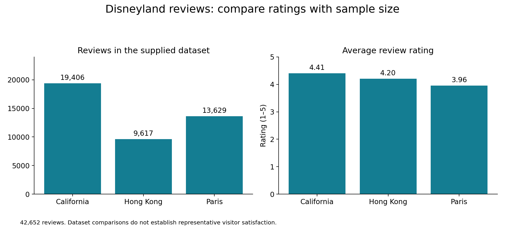

# Disneyland Reviews Analysis with Python

An academic Python project exploring 42,652 reviews across Disneyland California, Disneyland Hong Kong and Disneyland Paris.

## Project objectives

- Explore review counts and average ratings across three parks.
- Examine ratings by reviewer location and review month.
- Present findings through charts and a command-line interface.
- Export park summaries in TXT, CSV and JSON formats.

## Tools and techniques

- Python.
- CSV processing with the standard library.
- Matplotlib for visualisation.
- Functions, lists and dictionaries.
- Modular application structure.
- Abstract base classes for export functionality.

## Application structure

- `main.py`: application entry point and menu flow.
- `tui.py`: command-line prompts and output.
- `process.py`: data loading and calculations.
- `visual.py`: charts.
- `export.py`: TXT, CSV and JSON exports.

## Selected findings

| Park | Reviews | Average rating |
|---|---:|---:|
| California | 19,406 | 4.41 |
| Hong Kong | 9,617 | 4.20 |
| Paris | 13,629 | 3.96 |

California has the highest average rating in this dataset. The review counts and ratings describe the available sample and should not be treated as representative measures of all park visitors.

## Visual overview



Review volume and average rating are shown together to provide context for the comparison.

## Validation

Portfolio preparation checks included:

- Comparing park counts and mean ratings with independent calculations.
- Checking monthly and yearly calculations against the supplied data.
- Reading back the TXT, CSV and JSON exports.
- Exercising menu paths with scripted input, including invalid choices and exit.

These checks do not constitute a complete interactive usability test.

## My contribution

I developed the modular Python application, data-processing functions, visualisations and export functionality as part of my university programming assessment.

## Running the application

Python 3 and the dependencies listed in `requirements.txt` are required.

1. Download or clone this repository.
2. Obtain a compatible dataset from an authorised source.
3. Create a `data` folder beside `main.py` and place the file inside it as `disneyland_reviews.csv`.
4. Open a terminal in the repository folder and run:

```bash
python -m pip install -r requirements.txt
python main.py
```

On Windows, you can also use:

```powershell
py -m pip install -r requirements.txt
py main.py
```

The CSV must include a header row and these first five columns in order:

| Position | Field |
|---|---|
| 1 | Review ID |
| 2 | Rating |
| 3 | Year and month |
| 4 | Reviewer location |
| 5 | Park branch |

The application reads the file as UTF-8. Park values should use the dataset naming convention, such as `Disneyland_California`, `Disneyland_HongKong` and `Disneyland_Paris`.

Exports are written to the terminal's current working directory as `park_export.txt`, `park_export.csv` or `park_export.json`. Repeating an export can overwrite the corresponding file.

The source dataset is not included in this repository.

## Data and limitations

- The dataset contains 42,652 review records.
- 2,613 records have missing review dates.
- Reviewer location does not establish nationality.
- Monthly averages combine observations across years.
- Location rankings can be affected by very small sample sizes.
- Some original menu labels refer to nationality or popularity; the portfolio interpretation uses reviewer location and average rating.
- Monthly calculations return zero for months without matching records; this represents missing observations, not an observed zero rating.
- Dataset provenance and redistribution permission remain to be confirmed.

The source dataset is not included in the portfolio evidence package. Reproducing the application requires a compatible CSV file.

## Repository contents

- Python modules: original application code.
- `images/`: original charts and a portfolio comparison chart.
- `results/`: aggregate summaries in TXT, CSV and JSON, location rankings with sample counts, and a verification record.
- `requirements.txt`: Python dependencies.

Running the application requires the compatible source dataset described above.

## AI assistance

AI tools supported explanation, troubleshooting and portfolio documentation. Validation scope and known limitations are stated explicitly.

## Author

Ana Tinelli

- [GitHub](https://github.com/Ana-Tinelli)
- [LinkedIn](https://www.linkedin.com/in/ana-paula-tinelli-a90706131/)
